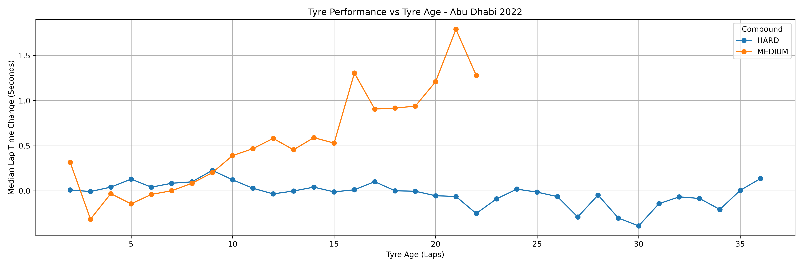
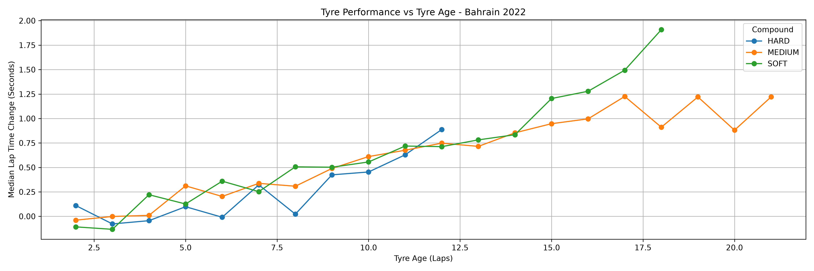
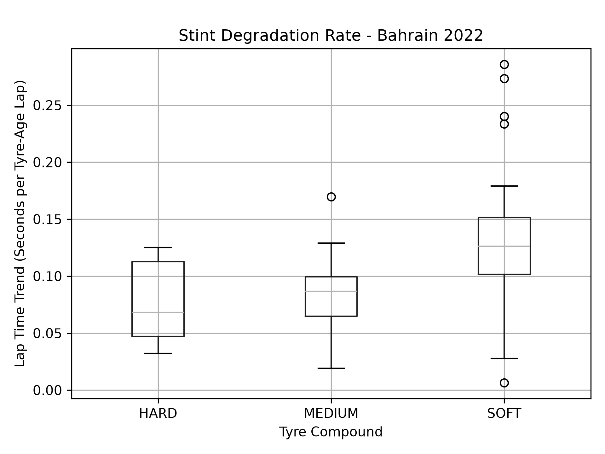
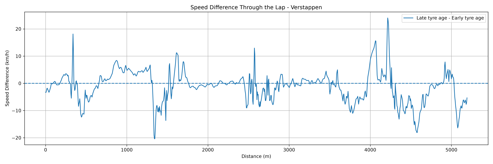

# F1 Tyre Degradation and Performance Analysis

An exploratory analysis of how lap times change with tyre age at the 2022 Bahrain and Abu Dhabi Grands Prix. The project uses FastF1 data to compare compounds, fit lap-time trends within longer stints, and inspect selected Abu Dhabi telemetry.

> Lap time is used as a proxy for tyre performance. This project does not measure physical tyre wear or isolate tyre effects from race conditions.

## Results at a glance

- **1,874** accurate green-flag laps across **129** stints
- **21** drivers and **3** compounds
- At Bahrain, median stint regression slopes were **0.0681 s/tyre-age lap** for hard, **0.0867** for medium, and **0.1261** for soft tyres.
- At Abu Dhabi, the corresponding estimates were **0.0023** for hard, **0.0740** for medium, and **0.0508** for soft tyres. The soft estimate came from only **3** qualifying stints.

These are descriptive summaries from two races. They are not causal estimates, and they should not be read as a direct measurement of tyre wear.

## Key figures

### Compound performance by tyre age

**Abu Dhabi**



**Bahrain**



### Stint-level lap-time trends



### Telemetry comparison



## Method

1. Load 2022 race lap, tyre and weather data with FastF1.
2. Remove laps missing lap time, tyre age, lap number or stint. Keep accurate laps recorded under green-flag track status.
3. For each driver stint, calculate a reference lap time from the mean of its first three retained laps. Express each lap as a difference from that reference.
4. Summarise median lap-time changes by event, compound and tyre age. Retain age groups with at least five lap samples across at least three distinct stints.
5. Fit a straight-line regression for stints with at least eight laps and eight distinct tyre ages. Report the slope in seconds per tyre-age lap.
6. Compare selected Verstappen telemetry laps near tyre ages 3, 10 and 18, and compare selected Verstappen and Pérez laps near target ages 3 and 10.

The stint reference is an early-stint baseline, not a new-tyre benchmark. Regression slopes can be negative when pace improves during a stint. R-squared and sample counts are provided as context, not as proof of causation or statistical confidence.

## Telemetry snapshot

For the selected Verstappen laps at Abu Dhabi, average speed was **207.91 km/h** near tyre age 3 and **205.19 km/h** near age 18. In the distance-aligned comparison, late minus early speed averaged **-1.07 km/h**, with local differences from **-20.37 to +24.03 km/h**. These selected laps illustrate how speed varies around the circuit; they are not a controlled comparison.

## Limitations

- Lap time reflects fuel load, traffic, strategy, driver pace, setup, track evolution, weather and circuit layout as well as tyre condition.
- Only two circuits are included, and their race conditions and compound use differ.
- Older tyre ages often have fewer samples. The coverage threshold does not guarantee precise estimates.
- Straight-line regression simplifies potentially non-linear stint behaviour. Fit quality varies between stints.
- The telemetry section uses selected laps from one event and does not control for car state, traffic, driving line or deployment.

## Run the notebook

Open `01_tyre_degradation.ipynb` and run the cells from top to bottom. The analysis uses Python, Jupyter, FastF1, pandas, NumPy and Matplotlib. FastF1 caches session data under `data/cache/`; uncached data requires network access. The notebook exports CSV summaries to `outputs/tables/` and plots to `outputs/graphs/`.

For a repeatable portfolio setup, record the package versions used in a `requirements.txt` file. Keep the FastF1 cache out of version control.

## Repository structure

```text
.
├── 01_tyre_degradation.ipynb
├── README.md
├── data/
│   └── cache/                 # local cache; exclude from Git
└── outputs/
    ├── graphs/
    └── tables/
```

Useful exported tables include `dataset_summary.csv`, `compound_performance_reliable.csv`, `degradation_rate_summary.csv`, `individual_stint_regressions.csv`, `weather_summary.csv`, `verstappen_telemetry_summary.csv` and `verstappen_vs_perez_speed.csv`.

## Data source

- [FastF1 documentation](https://docs.fastf1.dev/)
- [FastF1 source repository](https://github.com/theOehrly/Fast-F1)
